<p align="center">
  <picture>
    <source media="(prefers-color-scheme: dark)" srcset="docs/readme/banner.dark.png">
    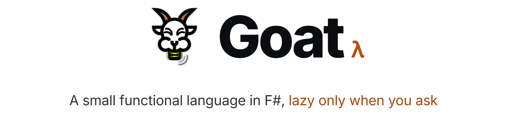
  </picture>
</p>

<p align="center">
  Goat is a small ML-flavoured language with pattern matching, algebraic data types, explicit
  laziness and an IO block. It comes with an interpreter, a REPL, a CLI and a standard library.
</p>

<p align="center">
  <!-- readme:buttons -->
  <a href="#run-locally"><picture><source media="(prefers-color-scheme: dark)" srcset="docs/readme/cta-run.dark.png"></picture></a>
  <a href="docs/README.md"><picture><source media="(prefers-color-scheme: dark)" srcset="docs/readme/cta-docs.dark.png">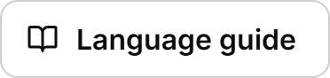</picture></a>
  <a href="docs/examples.md"><picture><source media="(prefers-color-scheme: dark)" srcset="docs/readme/cta-examples.dark.png"></picture></a>
  <!-- /readme:buttons -->
</p>

<p align="center">
  <!-- readme:status -->
  <a href="compiler/tests/Goat.Tests"><picture><source media="(prefers-color-scheme: dark)" srcset="docs/readme/badge-status-1.dark.png">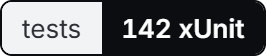</picture></a>
  <a href="compiler/examples"><picture><source media="(prefers-color-scheme: dark)" srcset="docs/readme/badge-status-2.dark.png">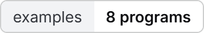</picture></a>
  <br>
  <a href="docs/lazy.md"><picture><source media="(prefers-color-scheme: dark)" srcset="docs/readme/badge-status-3.dark.png">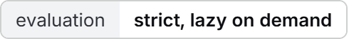</picture></a>
  <a href="LICENSE"><picture><source media="(prefers-color-scheme: dark)" srcset="docs/readme/badge-status-4.dark.png">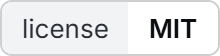</picture></a>
  <!-- /readme:status -->
</p>

<p align="center">
  <!-- readme:stack -->
  <picture><source media="(prefers-color-scheme: dark)" srcset="docs/readme/badge-stack-1.dark.png">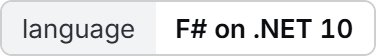</picture>
  <picture><source media="(prefers-color-scheme: dark)" srcset="docs/readme/badge-stack-2.dark.png">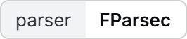</picture>
  <br>
  <picture><source media="(prefers-color-scheme: dark)" srcset="docs/readme/badge-stack-3.dark.png"></picture>
  <picture><source media="(prefers-color-scheme: dark)" srcset="docs/readme/badge-stack-4.dark.png">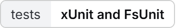</picture>
  <!-- /readme:stack -->
</p>

<p align="center">
  <!-- readme:nav -->
  <a href="#why-it-exists"><picture><source media="(prefers-color-scheme: dark)" srcset="docs/readme/badge-nav-1.dark.png"></picture></a>
  <a href="#a-taste"><picture><source media="(prefers-color-scheme: dark)" srcset="docs/readme/badge-nav-2.dark.png">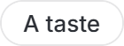</picture></a>
  <a href="#how-it-works"><picture><source media="(prefers-color-scheme: dark)" srcset="docs/readme/badge-nav-3.dark.png">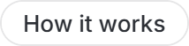</picture></a>
  <a href="#run-locally"><picture><source media="(prefers-color-scheme: dark)" srcset="docs/readme/badge-nav-4.dark.png">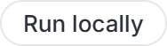</picture></a>
  <a href="#structure"><picture><source media="(prefers-color-scheme: dark)" srcset="docs/readme/badge-nav-5.dark.png">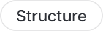</picture></a>
  <a href="#limitations"><picture><source media="(prefers-color-scheme: dark)" srcset="docs/readme/badge-nav-6.dark.png">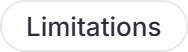</picture></a>
  <!-- /readme:nav -->
</p>

## Why it exists

Goat was built to take a language through every stage in one codebase: a grammar, a parser,
desugaring, an evaluator and a runtime with real IO. It keeps the parts that make functional
programming worth learning: functions as values, data described by its shape, and evaluation you
control. It stays small enough to read end to end in an afternoon.

Laziness is explicit. Code is strict by default, and `lazy` / `force` mark exactly where evaluation
is deferred, so infinite streams work without surprises in ordinary code. Side effects live in an
`io { … }` block, separate from pure expressions.

## A taste

```goat
fun rec sieve xs =
  match xs with
  | []        => []
  | p :: rest =>
      p :: lazy (sieve (lazyFilter (\x -> x mod p /= 0) (force rest)))

let primes = sieve (natsFrom 2)

fun main _ =
  io {
    do! println "First 10 primes:"
    do! println (show (take 10 primes))
  }
```

```text
First 10 primes:
[2, 3, 5, 7, 11, 13, 17, 19, 23, 29]
```

| Feature | Syntax |
|---|---|
| Bindings and functions | `let x = 42 in x * 2`, `fun double x = x * 2` |
| Recursion | `fun rec fact n = if n <= 0 then 1 else n * fact (n - 1)` |
| Lambdas and partial application | `\x -> x + 1`, `let add3 = add 3` |
| Pattern matching with guards | `match n with \| x when x > 0 => "pos" \| _ => "neg"` |
| Algebraic data types | `type Shape = Circle of r \| Rect of w h` |
| Lazy values and streams | `lazy (expensive ())`, `force t`, `n :: lazy (nats (n + 1))` |
| IO block | `io { let! s = readFile "f"; do! println s; return () }` |
| Lists, ranges, tuples | `[1, 2, 3]`, `[1..10]`, `x :: rest`, `(1, "a", true)` |
| Pipes | `xs \|> map f \|> filter g` |

The standard library covers lists, Option and Result, strings, math, file IO and combinators. The
full reference is in [docs/](docs/README.md).

## How it works

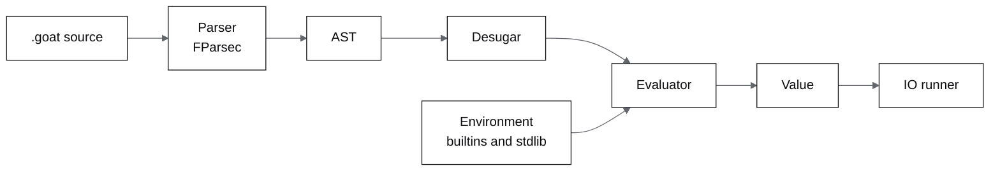

- **Parser.** FParsec combinators turn source into an AST with source spans, so errors point at a
  line and column.
- **Desugar.** Pipes become plain application, the lazy pipe wraps its argument in a thunk, and
  functions with parameters become lambdas, so the evaluator sees a smaller core.
- **Evaluator.** A tree-walking interpreter over immutable environments. Closures capture their
  environment; `lazy` creates a memoized thunk that is evaluated once on `force`.
- **Pattern matching.** Literals, variables, lists, cons, tuples, constructors, as-patterns,
  wildcards and guards. A value
  that matches no branch raises a match error with its location.
- **IO.** `main` returns an IO action. The runtime executes it, so reading files and printing stay
  out of pure code.
- **Errors.** Type, name, match, arity and division errors are values of one error type, reported
  with spans instead of .NET stack traces.

## Run locally

You need the .NET SDK 10.

```bash
git clone https://github.com/GoatWhistle/lang.git
cd lang/compiler
dotnet build Goat.slnx
dotnet run --project src/Goat.Cli -- run examples/lazy_streams.goat
```

| Command | What it does |
|---|---|
| `dotnet run --project src/Goat.Cli -- run <file>` | Parses, evaluates and runs `main` |
| `dotnet run --project src/Goat.Cli -- check <file>` | Parses and desugars without running |
| `dotnet run --project src/Goat.Repl` | Starts the REPL with `:load`, `:env`, `:reset` and `:help` |
| `dotnet test Goat.slnx` | Runs the 142 xUnit tests |

From `compiler/`, the Makefile wraps the same commands: `make build`, `make test`, `make repl`,
`make run FILE=examples/fibonacci.goat` and `make examples`.

## Structure

```text
compiler/
  src/Goat.Core      lexer, parser, AST, desugar, evaluator, pattern matching, builtins, stdlib
  src/Goat.Cli       run and check commands
  src/Goat.Repl      interactive REPL
  tests/Goat.Tests   parser, evaluator, pattern, lazy, IO, stdlib and integration tests
  examples/          eight programs, most with an .expected output file
docs/                language guide, standard library reference and annotated examples
```

The [examples](docs/examples.md) cover recursion, Fibonacci three ways, list operations, the sieve of
Eratosthenes on lazy streams, an Option monad, quicksort and mergesort, ADTs and file IO.

## Limitations

- Goat is dynamically typed. There is no static type checker; a type mismatch is a runtime error.
- Non-exhaustive matches are found at run time, not at parse time.
- Mutual recursion between top-level functions is not supported yet.
- It is a tree-walking interpreter, built for clarity rather than speed.

<p align="center">
  <picture><source media="(prefers-color-scheme: dark)" srcset="docs/readme/mark.dark.png"></picture>
  <br>
  <sub>Team GoatWhistle, 2026. Licensed under <a href="LICENSE">MIT</a>.</sub>
</p>
